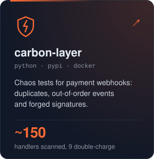
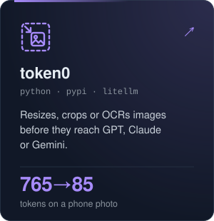
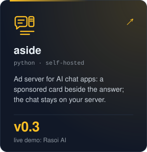

  

  
  
  
  

  

##  Things I ship

  
  
  

##  Recent writing

<table>
  <tr><td></td><td><a href="https://dev.to/pritom14/i-built-an-open-source-ad-server-for-ai-chat-apps-that-keeps-the-chat-on-your-server-15lh">I built an open-source ad server for AI chat apps that keeps the chat on your server</a></td></tr>
  <tr><td></td><td><a href="https://dev.to/pritom14/running-your-own-ad-server-means-doing-ad-ops-so-i-gave-the-job-to-my-ai-agent-4fj8">Running your own ad server means doing ad ops, so I gave the job to my AI agent</a></td></tr>
  <tr><td></td><td><a href="https://dev.to/pritom14/i-read-150-public-razorpay-webhook-handlers-at-least-9-would-process-the-same-payment-twice-1bnb">I read ~150 public Razorpay webhook handlers. At least 9 would process the same payment twice</a></td></tr>
  <tr><td></td><td><a href="https://dev.to/pritom14/i-cut-vision-llm-costs-by-989-heres-how-token0-works-under-the-hood-4ldc">How token0 cuts vision-LLM costs, under the hood</a></td></tr>
</table>

##  Toolbox

  

 <b>Random facts</b> (go on, click)

 

- My bio says "lazy". My commit graph disagrees.
- On GitHub since 2016, back when everything I built was an Android app. Most of my 150-odd public repos are fossils from that era.
- Favourite bug class: the one that only shows up when a webhook arrives twice.
- If a task happens three times, it gets a script. If the script runs three times, it gets an agent.

